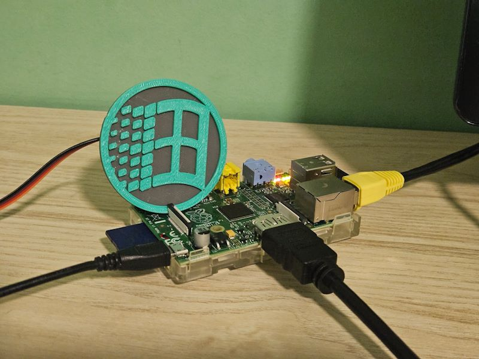

# Windows Embedded Compact (CE) on Raspberry Pi

This project is a Board Support Package (BSP) for the BCM2835-based Raspberry Pi single-board computers (Raspberry Pi 1 A/B, Pi Zero/Zero W), made for Windows Embedded Compact 7 (CE 7.0).

 

 

<small>[3D model for the CE logo](https://www.printables.com/model/1675195-windows-ce-logo)</small>

This project was started out in 2013 by **Doug Boling** (Boling Consulting Inc, 
[www.bolingconsulting.com](http://bolingconsulting.com)) over on [Codeplex](https://web.archive.org/web/20140417034241/http://ceonpi.codeplex.com/) (RIP), but development stopped at the USB host controller driver. All the important work of getting the bootloader set up, a basic display driver and debugger connection has been layed out, but due to no USB drivers it wasn't usable.

See [Original README of 2013 project](docs/codeplex_readme.md) and [original author update from 2018](http://bolingconsulting.com/2018/what-happened-to-the-raspberry-pi-project/).

I picked up work in late 2026 and got a USB host driver working, making this BSP now usable. Still there's more drivers needed to get this project into a usable state.

Images with KITL disabled (`IMGNOKITL=1`) boot very fast, around 10 seconds from the moment power is applied.

### Disclaimers

**This BSP isn't intended for any serious use.** Windows CE is very much deprecated and has been replaced everywhere with Linux and especially Android for HMI.

**AI assistance has been used to develop these drivers.** This is merely a hobby project, and I only have basic knowledge of both the CE driver stack and the actual hardware of the Pi. 
This README document is mostly handwritten, but architecture docs under `docs/` are predominantly AI generated.

## Building the image

**TBA**: Description of how to install WEC7 Platform Builder and get the project ready

## Installation

This is very easy. An SD card of any size is needed, formatted to a single FAT partition (FAT32 for cards over 2 GB). Every image build (Make Run-Time Image) creates an `sdcard` folder in the Platform Builder release directory with everything the card needs; copy the **contents** of that folder to the root of the card:

    bootcode.bin       Raspberry Pi firmware
    start.elf          Raspberry Pi firmware
    fixup.dat          Raspberry Pi firmware
    start_cd.elf       cut-down firmware, used with gpu_mem=16
    fixup_cd.dat       cut-down firmware, used with gpu_mem=16
    LICENCE.broadcom   firmware licence
    config.txt
    kernel.img

The firmware files and `config.txt` live in [raspi2/files/sdboot](raspi2/files/sdboot); the firmware comes from the official Raspberry Pi firmware repository ([raspberrypi/firmware](https://github.com/raspberrypi/firmware/tree/master/boot)) and is redistributed under its licence (`LICENCE.broadcom`). I was a little surprised that the latest work just fine, I expected I'd have to dig up the old boot files from 2013.

The `config.txt` file is quite short:

    hdmi_force_hotplug=1
    disable_overscan=1
    init_uart_clock=3000000
    gpu_mem=32

None of these config lines are needed to boot the kernel, but do come in handy:

- `hdmi_force_hotplug=1` makes the display work even if it's not attached at power on time
- `disable_overscan=1` makes the image fill the entire screen (needed at 1080p)
- `init_uart_clock=3000000` sets the UART clock to 3 MHz (the default is 48 MHz) 
needed so the UART works properly at 115200 baud (future investigation into configuring UART clock dividers for 115200 @ 48 MHz needed)
- `gpu_mem=32` reduce amount of memory allocated to the GPU to free up more memory for general use - may be removed or changed later depending on how the Video driver evolves

`kernel.img` is the built CE kernel together with it's ROM file system. It is a copy of `NK.nb0` made by `PostMakeimg.bat` (through `mksdcard.js`); `NK.nb0` itself stays in the release directory. With the "SD card as root file system" catalog item, the `sdcard` folder also holds the desktop shortcuts and startup folders (see [docs/sdroot.md](docs/sdroot.md)). The image is linked at offset `0x80008000` and is loaded in the same way as the Linux kernel.

## Board support

The original project was only tested on the original Raspberry Pi Model B, since that was the only board that existed at the time. Luckily, the Pi Zero uses the same SoC, and the original BSP has booted to a desktop just fine with no modifications.

Most of the work was done on the Pi Zero W. The Ethernet driver was developed and tested on a Pi 1 Model B.

| Board | Features |
|-|-|
| Pi Zero (W) | HDMI, USB host |
| Pi 1 Model B | HDMI, USB host, Ethernet |

## Catalog items

The BSP contains a bunch of optional add-ins that can be enabled using the Catalog Items View:

- **Applications**
    - **CPU Idle Monitor (demo)** - shows the % of idle CPU time
    - **Shut Down dialog (poweroff.exe)** - convenient way of shutting down or restarting the OS
- **Storage**
    - **Load optional modules from the SD card** - offload some binaries (IE7, network tools) to the SD card to reduce kernel.img size   Depends on the "SD card as root file system" item
    - **SD card as root file system** - mounts the SD card at `\` instead of `\Storage Card`, useful for persistence

## Hardware driver support

### Current

These are hardware features that are functional

| Feature | Driver State | Comments |
|-|-|-|
| UART | Basic | Used for KITL debugger connection with Visual Studio |
| Display | Basic | Fixed resolution, no acceleration whatsoever |
| [USB Host](docs/usb.md) | Almost complete | Supports all speeds (low[^1], full, high), USB hubs, input devices and mass storage  |
| [SD Host](docs/sdhost.md) | Basic | Mounts FAT/exFAT partitions from the SD card, read and write. PIO only[^2] |
| [USB Ethernet](docs/ethernet.md) | Working | SMSC LAN9512 on the Pi 1 Model B: DHCP, IPv4/IPv6, firmware MAC address. ~5.6 MB/s receive, ~3.8 MB/s send (Release build) |
| Power | Basic | CPU idles with WFI. Restart through the SoC watchdog; Start > Suspend shuts down (firmware halt, power cycle to restart). Optional apps: CPU idle monitor, Shut Down dialog |
| Real-Time Clock | Software | The Pi has no battery-backed RTC. The clock runs from the 1 MHz system timer and starts at the image build date on each boot; time set in Date/Time lasts until reboot |

[^1]: Low-speed USB devices won't work when connected to a Full-speed USB hub directly attached to the root port. 
Only applies to full-speed USB 1.1 hubs and the Pi Zero, since Pi 1 has a built-in USB 2.0 hub. 
This is a hardware limitation of the DWC2 controller, see [docs/usb.md](docs/usb.md) for more details.

[^2]: SD transfers use PIO (programmed I/O), not DMA. The BCM2835 Arasan's built-in SDHCI DMA (SDMA/ADMA2) does not work: the controller needs the external BCM DMA engine with EMMC DREQ pacing (as the FreeBSD and Linux drivers use), which the CE standard SD host MDD cannot drive. Driving the external DMA engine is a possible future improvement.

### Future goals

Things I plan on getting working, in order of priority

| Feature | Comments |
|-|-|
| Audio | Support the built-in analog audio output of the Pi 1 model B |
| GPIO, I2C, SPI, UART | Let CE apps control pins and peripherals (need to see if there's a standard CE API for this) |
| Better Display | Support Composite output, no hardcoded resolution in CE image |
| SD Host DMA | Current SD driver is PIO only; add external BCM DMA engine support (DREQ-paced) for faster transfers |
| USB Function | Useful only on the Pi Zero, let the Pi be connected as a USB device to a computer (for ActiveSync or Mass Storage) |
| USB Isochronous mode | Needed for USB audio and video class devices CE only includes a USB audio driver |

### Stretch goals

These are features I don't have much hope at implementing

| Feature | Comments |
|-|-|
| SDIO Wi-Fi | Support for the built-in Wi-Fi of the Pi Zero W |
| Bluetooth | Support for the built-in Bluetooth of the Pi Zero W |
| GPU Acceleration | I just know that the driver situation on Linux is not the greatest, with Broadcom obviously being at fault |

### Other features

- Splash screen on boot as an option, instead of the KITL output